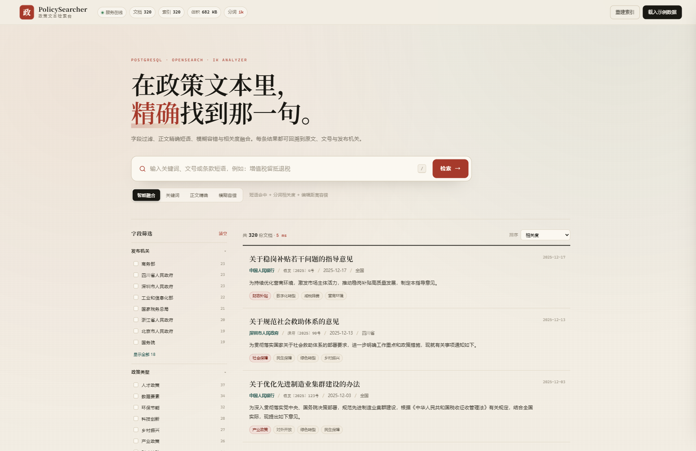
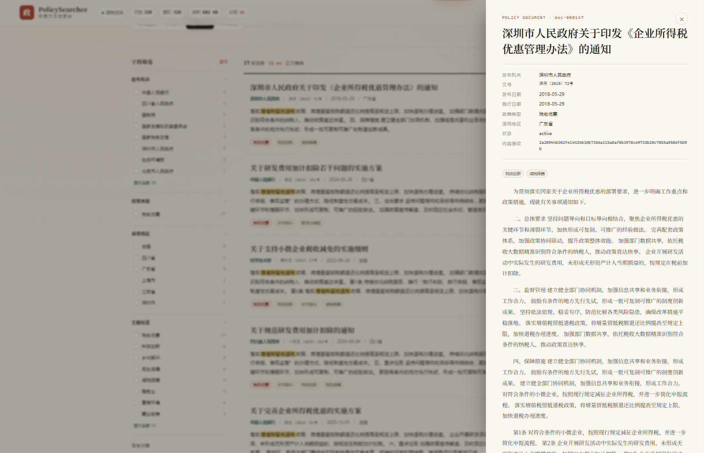

# PolicySearcher · 政策文本检索台

面向政策文本的检索原型：**PostgreSQL 做文档目录与原文存储，OpenSearch 2.19.3 + IK 做倒排检索**，FastAPI 提供接口，前端零构建、由后端直接托管。

当前阶段先打通「检索器 + 可测试前端」：320 份中文政策示例数据，支持字段筛选、精确短语、模糊容错、相关度融合、高亮、分面与详情回看。





---

## 1. 当前能力

- **四种检索模式**
  - `smart`：短语命中 + 分词相关度 + 编辑距离容错
  - `keyword`：BM25 关键词检索
  - `exact`：正文/标题/摘要短语匹配
  - `fuzzy`：`fuzziness=AUTO` 的容错检索
- **字段过滤**：发布机关、政策类型、适用地区、主题标签、发布日期范围
- **分面统计**：检索结果按机关、类型、地区、标签聚合
- **结果体验**：标题与正文高亮、得分、分页、排序、详情抽屉、原文链接
- **管理接口**：示例数据导入、按 PostgreSQL 重建索引、清空、运行状态
- **实测性能**：本机 320 篇、单节点、1GB heap，单次查询约 **4–64 ms**
- **跨平台部署**：Node 22 + npm 脚本，自动检测 Python / Docker / 端口，向导式生成 `.env`

> 这是检索链路与前端交互的测试版本，不是 100 万文档的最终容量方案。容量与部署注意事项见第 9 节。

---

## 2. 架构

```text
浏览器
  │  http://127.0.0.1:8000
  ▼
FastAPI（backend/app）
  ├── PostgreSQL 16        文档目录、原文、文号、机关、日期、标签（source of truth）
  └── OpenSearch 2.19.3    检索副本 + IK 中文分词 + 倒排索引（search copy）
        └── analysis-ik 2.19.3 + 自定义政策词典
```

- **PostgreSQL 是唯一事实来源**，保存完整正文。
- **OpenSearch 只保存检索所需的副本**，可随时从 PostgreSQL 全量重建。
- 前端是原生 HTML/CSS/JS，无 Node 构建步骤，由 FastAPI 的 `StaticFiles` 托管。
- Node 只负责部署编排和进程启动，不参与页面构建。

### 目录

```text
PolicySearcher/
├─ backend/
│  ├─ app/
│  │  ├─ config.py              # 数据库 / OpenSearch 配置（读取根目录 .env）
│  │  ├─ database.py            # SQLAlchemy engine / session
│  │  ├─ models.py              # documents 表
│  │  ├─ migrations.py          # schema_version 与轻量迁移器
│  │  ├─ schemas.py             # API 请求 / 响应模型
│  │  ├─ main.py                # FastAPI 入口、迁移、索引初始化、静态托管
│  │  ├─ routers/               # search / documents / admin
│  │  └─ services/
│  │     ├─ catalog.py          # PostgreSQL 批量 upsert / 查询 / 统计
│  │     ├─ index_service.py    # OpenSearch 索引、mapping、bulk、IK 探测
│  │     ├─ search_service.py   # 四种检索模式、过滤、分面、高亮
│  │     └─ sample_data.py      # 确定性中文政策示例数据
│  ├─ scripts/
│  │  ├─ seed.py                # 示例数据导入（支持 --if-empty / --reset）
│  │  └─ migrate.py             # 数据库迁移入口
│  └─ requirements.txt
├─ deploy/opensearch/
│  ├─ Dockerfile                # OpenSearch + IK 镜像
│  ├─ opensearch-analysis-ik-2.19.3.zip
│  └─ ik-config/config/         # IK 词典与 IKAnalyzer.cfg.xml
├─ frontend/                    # index.html / styles.css / app.js
├─ tools/
│  ├─ deploy.mjs                # npm run deploy：环境检测 + 向导 + 安装 + 初始化
│  ├─ start.mjs                 # npm start：确保容器并启动 FastAPI
│  ├─ doctor.mjs                # npm run doctor：环境诊断
│  ├─ infra.mjs                 # 容器 up/down/status/logs
│  ├─ seed.mjs / migrate.mjs    # 数据与迁移快捷命令
│  └─ lib.mjs                   # 跨平台进程 / Docker / 端口 / .env 工具
├─ scripts/                     # 旧版 PowerShell + WSL 辅助脚本（保留兼容）
├─ docker-compose.yml
├─ package.json
├─ package-lock.json
├─ .env.example
├─ .nvmrc
└─ .gitignore
```

---

## 3. 环境要求与 Docker 说明

### 必需环境

| 依赖 | 要求 | 说明 |
| --- | --- | --- |
| Node.js | **≥ 20，建议 22** | npm 随 Node 安装；仓库含 `.nvmrc`，可用 `nvm use`；本项目没有第三方 npm 依赖 |
| Python | **3.10+** | `deploy` 会创建 `.venv` 并安装 `backend/requirements.txt` |
| Docker | Engine + Compose v2 | Windows 可用 Docker Desktop，或 WSL 内的 Docker Engine |

> 不存在 “npm 22” 这个版本；Node 22 自带的是 npm 10/11。本项目按 Node 22 + npm 10.9.4 验证。

`npm run deploy` 会检测 Python、Docker、Compose、端口和磁盘空间，并安装项目依赖；但 **Node、Python、Docker 本身属于宿主机前置条件**，不会由 npm 自动安装。

### 本机 Docker 现状（重要）

这台机器上的 **Docker Desktop 目前不可用**，原因不是镜像或网络，而是它的 WSL 数据盘被搬家工具移到了：

```text
E:\金山毒霸搬家目录\其他类型文件\docker_data.vhdx
```

`C:\Users\gengc\AppData\Local\Docker\wsl\disk\docker_data.vhdx` 只是指向它的符号链接，WSL 执行
`wsl.exe --mount --bare --vhd` 时返回 `Wsl/Service/AttachDisk/MountDisk/HCS/E_ACCESSDENIED`，Docker Desktop 因此无法启动。

当前采用的办法是**完全绕开 Docker Desktop**：

- Docker Engine **29.8.2** 已安装在 WSL 发行版 **`Ubuntu-Clean`** 内，systemd 管理，`docker` 组可用。
- Docker Compose **v5.6.0** 安装在 `~/.docker/cli-plugins/docker-compose`，不需要 sudo。
- `.wslconfig` 从 `networkingMode=mirrored` 改为 `NAT`，这样 Windows 才能通过 `localhost` 访问容器端口。
  - 原配置备份在 `C:\Users\gengc\.wslconfig.bak`。
- Docker Hub 直连存在 DNS 污染，默认镜像使用 `m.daocloud.io/docker.io/...` 前缀。
- **不要启动 Docker Desktop**，它会再次尝试挂载那个损坏的数据盘；本项目也不依赖它。

> WSL 在 NAT 模式下可能输出 `检测到 localhost 代理配置...` 的提示；这是 WSL 的无害警告，不影响容器端口访问。`npm` 脚本已设置 `WSL_UTF8=1`，避免中文乱码。

`npm run deploy` 会按 `DOCKER_MODE=auto` 自动选择：

1. 本机 `docker info` 可用 → 使用本机 Docker；
2. 否则在 Windows 上尝试 `WSL_DISTRO`（默认 `Ubuntu-Clean`）里的 Docker；
3. 都不可用 → 给出明确提示，不继续。

在 Linux 服务器或 macOS 上，直接使用原生 Docker Engine + Compose 即可，不需要 WSL 兼容层。

---

## 4. 快速开始（npm）

### 首次部署

```powershell
cd E:\PolicySearcher
npm run deploy
```

> **注意**：`npm deploy` 不是 npm 的内置命令，正确写法是 **`npm run deploy`**；`npm start` 是内置别名，可以直接使用。

交互式向导会询问：

- 应用监听地址与端口（默认 `127.0.0.1:8000`；服务器可填 `0.0.0.0`）
- PostgreSQL 端口、用户、密码、数据库名
- OpenSearch 端口与索引名
- 是否导入示例数据、导入条数（默认 320）
- 已有 `.env` 是否覆盖

随后自动执行：

1. 检测 Node / Python / Docker / Compose / 端口 / 磁盘；
2. 生成或更新根目录 `.env`（权限尽量设为 600，且已被 `.gitignore` 忽略）；
3. 创建 `.venv`，安装 `backend/requirements.txt`；
4. `docker compose up -d --build` 启动 PostgreSQL 与 OpenSearch+IK；
5. 等待 `pg_isready` 与 OpenSearch 集群健康；
6. 执行数据库迁移，记录 `schema_version`；
7. 数据库为空时导入示例数据；已有数据则跳过，不会覆盖。

非交互部署（CI、服务器首次初始化）：

```powershell
npm run deploy -- --yes
```

常用参数：

| 参数 | 作用 |
| --- | --- |
| `--yes` | 使用现有 `.env` / 默认值，不进入交互 |
| `--port 8001` | 覆盖应用端口 |
| `--force` | 覆盖已有 `.env` |
| `--skip-install` | 跳过 pip 安装，但会检查依赖是否已存在 |
| `--skip-build` | 不重新构建 OpenSearch/IK 镜像 |
| `--skip-seed` | 不导入示例数据 |
| `--reset` | 清空现有文档并重新导入示例数据（危险） |
| `--upgrade` | pip 使用 `--upgrade`，并重建镜像 |

示例：

```powershell
npm run deploy -- --yes --port 8001
npm run deploy -- --reset
npm run deploy -- --upgrade
```

### 启动服务

```powershell
npm start
```

`npm start` 会：

1. 读取根目录 `.env`；
2. 确保 PostgreSQL / OpenSearch 容器已启动；
3. 等待端口与 OpenSearch 健康；
4. 用 `.env` 中的 `APP_HOST` / `APP_PORT` 启动 uvicorn。

临时换端口：

```powershell
npm start -- --port 8010
```

不启动容器（例如数据库在远端）：

```powershell
npm start -- --no-infra
# 或
$env:SKIP_INFRA=1; npm start
```

停止 FastAPI 用 `Ctrl+C`；容器会保持运行。要停止容器：

```powershell
npm run infra:down
```

### 常用命令

| 命令 | 作用 |
| --- | --- |
| `npm run deploy` | 一键部署 / 更新配置 |
| `npm start` | 按 `.env` 启动服务 |
| `npm run doctor` | 检查 Node / Python / Docker / 端口 / 服务 |
| `npm run migrate` | 检查并应用数据库迁移 |
| `npm run seed -- 320` | 数据库为空时导入示例数据 |
| `npm run seed -- 320 --reset` | 清空并重新导入示例数据 |
| `npm run infra:up` | 启动并构建容器 |
| `npm run infra:down` | 停止容器（保留数据卷） |
| `npm run infra:status` | 查看容器状态 |
| `npm run infra:logs` | 查看最近容器日志 |
| `npm run infra:restart` | 重启容器 |
| `npm run infra:pull` | 拉取基础镜像 |

### 旧版 PowerShell 脚本

原来的 `scripts/start-stack.ps1` / `stop-stack.ps1` 仍保留，适合只想使用 WSL Docker 的 Windows 环境；新环境建议优先使用 npm 脚本。

```powershell
powershell -ExecutionPolicy Bypass -File .\scripts\start-stack.ps1
powershell -ExecutionPolicy Bypass -File .\scripts\stop-stack.ps1
```

---

## 5. API

| 方法 | 路径 | 说明 |
| --- | --- | --- |
| `POST` | `/api/search` | 检索 |
| `GET` | `/api/documents/{doc_id}` | 文档详情（含完整正文） |
| `GET` | `/api/stats` | 文档数、索引数、索引体积、分词器、状态 |
| `POST` | `/api/admin/seed` | 导入示例数据，`{ "count": 320, "reset": true }` |
| `POST` | `/api/admin/reindex` | 按 PostgreSQL 全量重建 OpenSearch 索引 |
| `POST` | `/api/admin/clear` | 清空文档与索引 |
| `GET` | `/api/health` | 服务与 OpenSearch 健康状态 |

### 检索请求

```json
{
  "query": "增值税留抵退税",
  "mode": "smart",
  "filters": {
    "issuers": [],
    "categories": ["税收优惠"],
    "regions": ["全国"],
    "tags": [],
    "date_from": "2020-01-01",
    "date_to": null
  },
  "page": 1,
  "size": 10,
  "sort": "relevance",
  "slop": 2
}
```

- `mode`：`smart` / `keyword` / `exact` / `fuzzy`
- `sort`：`relevance` / `date_desc` / `date_asc`
- `slop`：精确短语允许的词间距，默认 2

### 检索响应（节选）

```json
{
  "total": 17,
  "page": 1,
  "size": 10,
  "took_ms": 18,
  "mode": "smart",
  "query": "增值税留抵退税",
  "hits": [
    {
      "doc_id": "doc-000123",
      "title": "关于优化增值税留抵退税的意见",
      "doc_number": "国办发〔2024〕12号",
      "issuer": "国务院",
      "region": "全国",
      "category": "税收优惠",
      "tags": ["减税降费", "惠企政策"],
      "issue_date": "2024-05-10",
      "score": 65.20734,
      "highlights": [
        { "field": "title", "text": "关于优化<mark>增值税留抵退税</mark>的意见" }
      ]
    }
  ],
  "facets": {
    "issuers": [{ "value": "国务院", "count": 8 }],
    "categories": [{ "value": "税收优惠", "count": 17 }],
    "regions": [{ "value": "全国", "count": 9 }],
    "tags": [{ "value": "减税降费", "count": 7 }]
  }
}
```

---

## 6. 索引与 IK 分词

索引 mapping 定义在 `backend/app/services/index_service.py`：

- `title` / `summary` / `content`：`text`
  - 写入分析器：`policy_index`（`ik_max_word`）
  - 查询分析器：`policy_search`（`ik_smart`）
- `doc_number` / `issuer` / `region` / `category` / `tags` / `status`：`keyword`
- `issue_date` / `effective_date`：`date`
- `dynamic: strict`，未知字段会被拒绝，保证 mapping 可控

IK 词典位于：

```text
deploy/opensearch/ik-config/config/
├─ IKAnalyzer.cfg.xml     # ext_dict = custom.dic
├─ custom.dic             # 政策领域自定义词
└─ main.dic / stopword.dic / ...
```

当前自定义词包括：`增值税留抵退税`、`留抵退税`、`专精特新`、`专精特新中小企业`、`碳达峰`、`碳中和`、`数据要素`、`新质生产力`、`研发费用加计扣除` 等。

修改词典后需要重建 OpenSearch 镜像（词典是烤进镜像的），再重建索引：

```powershell
npm run infra:up
npm run migrate
# 通过 API 或脚本重建索引；示例数据场景可直接：
npm run seed -- 320 --reset
```

验证分词：

```powershell
.\.venv\Scripts\python.exe backend\scripts\analyze_test.py
```

---

## 7. 配置

`npm run deploy` 会在项目根目录生成 `.env`。`.env` 已被 `.gitignore` 忽略，不要提交。

主要变量：

| 变量 | 默认值 | 说明 |
| --- | --- | --- |
| `APP_HOST` | `127.0.0.1` | 服务监听地址；服务器可设 `0.0.0.0` |
| `APP_PORT` | `8000` | FastAPI 端口 |
| `CORS_ORIGINS` | `*` | 逗号分隔的来源 |
| `POSTGRES_HOST` | `127.0.0.1` | PostgreSQL 主机 |
| `POSTGRES_PORT` | `5432` | 宿主机映射端口 |
| `POSTGRES_USER` | `policy` | 数据库用户 |
| `POSTGRES_PASSWORD` | 首次生成 | 数据库密码 |
| `POSTGRES_DB` | `policy_search` | 数据库名 |
| `DATABASE_URL` | 自动生成 | SQLAlchemy 连接串 |
| `POSTGRES_IMAGE` | 镜像仓库地址 | 可换成 `postgres:16-alpine` |
| `OPENSEARCH_URL` | `http://127.0.0.1:9200` | OpenSearch 地址 |
| `OPENSEARCH_INDEX` | `policy_documents` | 索引名 |
| `OPENSEARCH_JAVA_OPTS` | `-Xms1g -Xmx1g` | 单节点堆内存 |
| `OPENSEARCH_IMAGE` | `policysearcher/opensearch-ik:2.19.3` | IK 镜像 |
| `OPENSEARCH_BASE_IMAGE` | OpenSearch 2.19.3 | 构建基础镜像 |
| `SEED_COUNT` | `320` | 示例数据条数 |
| `SEED_ON_DEPLOY` | `true` | 部署时是否导入 |
| `DOCKER_MODE` | `auto` | `auto` / `local` / `wsl` |
| `WSL_DISTRO` | `Ubuntu-Clean` | Windows WSL Docker 发行版 |
| `TZ` | `Asia/Shanghai` | 容器时区 |

注意：

- **改 PostgreSQL 密码不会自动修改已有数据卷里的角色密码。** 已有数据卷时，`deploy` 会沿用现有容器密码；如果要换密码，需要先备份，再在容器内执行 `ALTER ROLE`，或删除数据卷后重新初始化（会丢数据）。
- `POSTGRES_IMAGE` / `OPENSEARCH_BASE_IMAGE` 默认走 `m.daocloud.io` 镜像前缀；网络条件不同可改成官方镜像。
- 在服务器上把 `APP_HOST` 设为 `0.0.0.0`，并配置防火墙 / 反向代理。

---

## 8. 数据库版本与迁移

- `backend/app/migrations.py` 维护 `SCHEMA_VERSION`。
- 启动或执行 `npm run migrate` 时，会：
  1. `Base.metadata.create_all()` 创建缺失表；
  2. 确保 `app_meta` 表存在；
  3. 读取 `schema_version`；
  4. 按 `MIGRATIONS` 注册表顺序应用未执行的迁移；
  5. 写回版本号。
- 如果数据库版本高于程序支持版本，会拒绝启动，避免旧代码破坏新数据。

新增迁移的写法：

```python
# backend/app/migrations.py
MIGRATIONS: dict[int, Callable[[Connection], None]] = {
    2: _migrate_v2_add_column,
}
```

把 `SCHEMA_VERSION` 改为 `2`，部署时 `npm run deploy` 会自动执行一次。

---

## 9. 已知限制与下一步

### 当前限制

- **数据规模**：示例 320 篇，每篇约 800 字；尚未做 100 万级导入与容量验证。
- **单节点**：OpenSearch 单分片、0 副本、1GB heap；生产需要多分片、副本、独立数据盘与更合理的堆外内存。
- **无权限体系**：尚未接入登录、角色、文档级权限。
- **无文件导入 UI**：当前只有示例数据接口；PDF/Word/HTML 解析、分块、去重、任务队列尚未实现。
- **无向量检索**：RAG 与 embedding 暂未接入，先把精确/模糊检索链路跑通。
- **跨平台边界**：Node / Python / Docker 是宿主机前置条件；`deploy` 不会静默安装系统级运行时。
- **Windows 兼容层**：本机依赖 `Ubuntu-Clean` 里的 Docker Engine 与 NAT 模式；服务器部署应改用原生 Docker。
- **npm 命令**：`npm deploy` 不是 npm 内置命令，必须使用 `npm run deploy`；`npm start` 可直接用。

### 面向 100 万文档的下一步

1. **导入管线**：文件解析 → 文本清洗 → 去重（`file_hash`）→ 分块 → PostgreSQL 落库 → 批量写 OpenSearch。
2. **索引治理**：按时间/地区分索引或分片，`refresh_interval` 调大，使用 `_bulk` 分批写入，避免频繁 refresh。
3. **检索优化**：字段权重、同义词、`search_after` 深分页、`terminate_after`、缓存热点查询。
4. **权限与审计**：文档级 ACL、检索日志、敏感词与脱敏。
5. **前端管理台**：上传、解析预览、分块编辑、向量化任务状态、索引重建进度。
6. **向量与 RAG**：在精确检索稳定后，再接入 embedding、向量库与重排。

---

## 10. 验证记录

本项目已完成以下本机验证：

- `npm run deploy -- --yes`：完成环境检测、`.env` 生成、依赖安装、容器启动、迁移与空库检查
- `npm start -- --port 8010`：使用 `.env` 配置启动成功
- `npm run infra:down` 后再 `npm start`：容器重新创建、数据卷保留，文档与索引仍为 320
- `GET /api/health`：`status=ok`，`opensearch=online`
- `GET /api/stats`：`documents=320`，`index_docs=320`，`analyzer=ik`
- IK 分词：`增值税留抵退税`、`专精特新中小企业` 可正确成词
- 检索：`增值税留抵退税` 命中 17 条；`专精特新` 命中 24 条；四种模式均返回结果
- 延迟：单次查询 4–64 ms（320 篇、单节点）
- 前端：检索、模式切换、facets 过滤、日期筛选、分页、详情抽屉、示例导入、重建索引均已手工验证
- `npm run doctor`：Python / WSL Docker / Compose / PostgreSQL / OpenSearch / 端口检查通过
